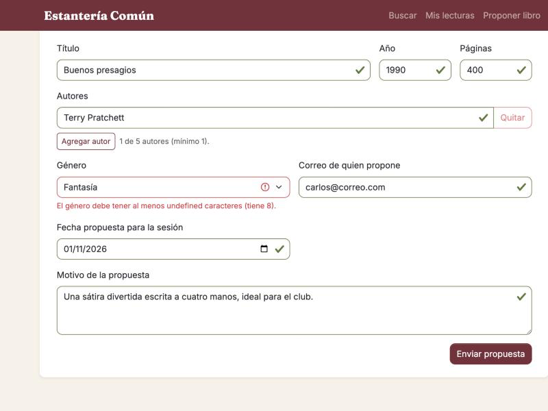
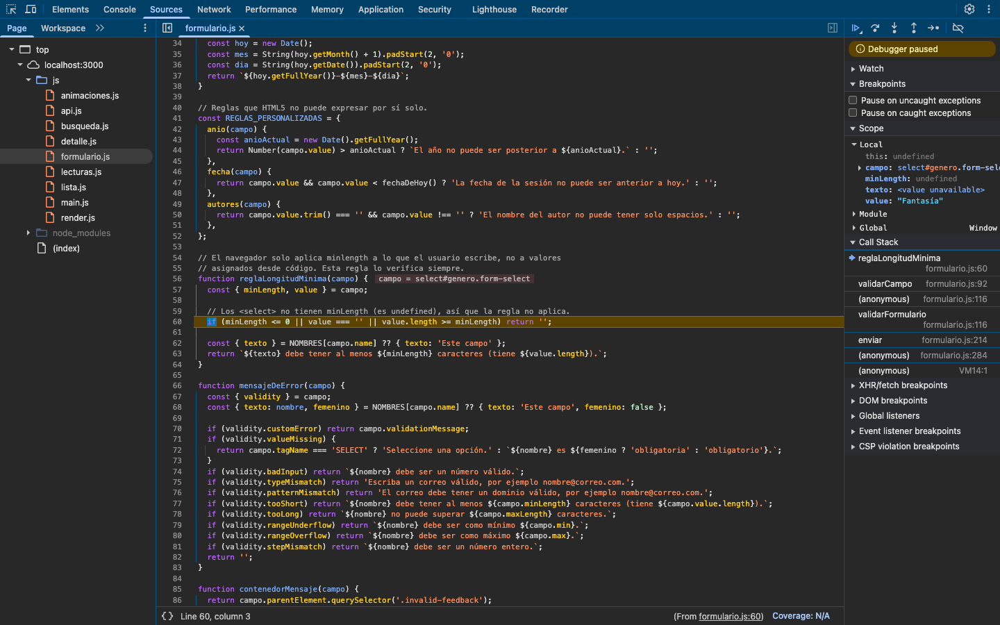
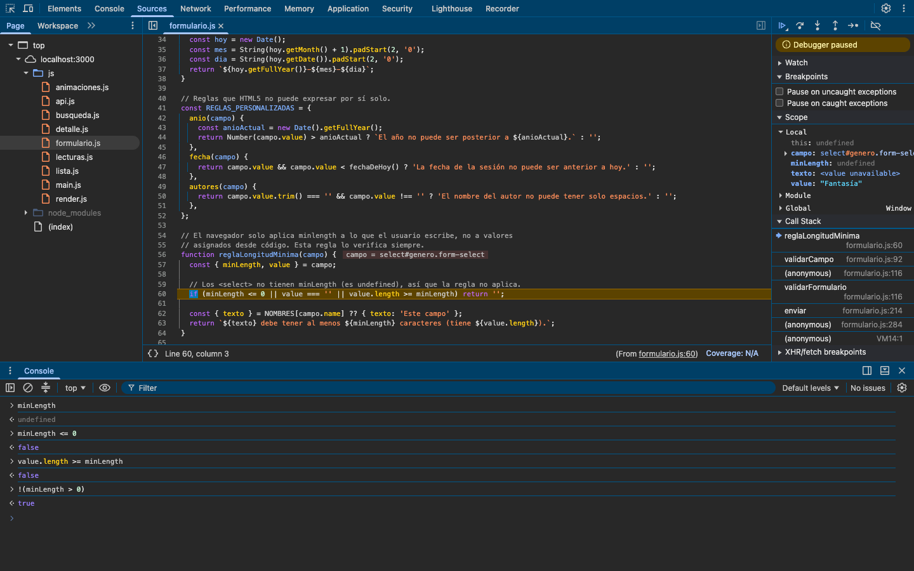
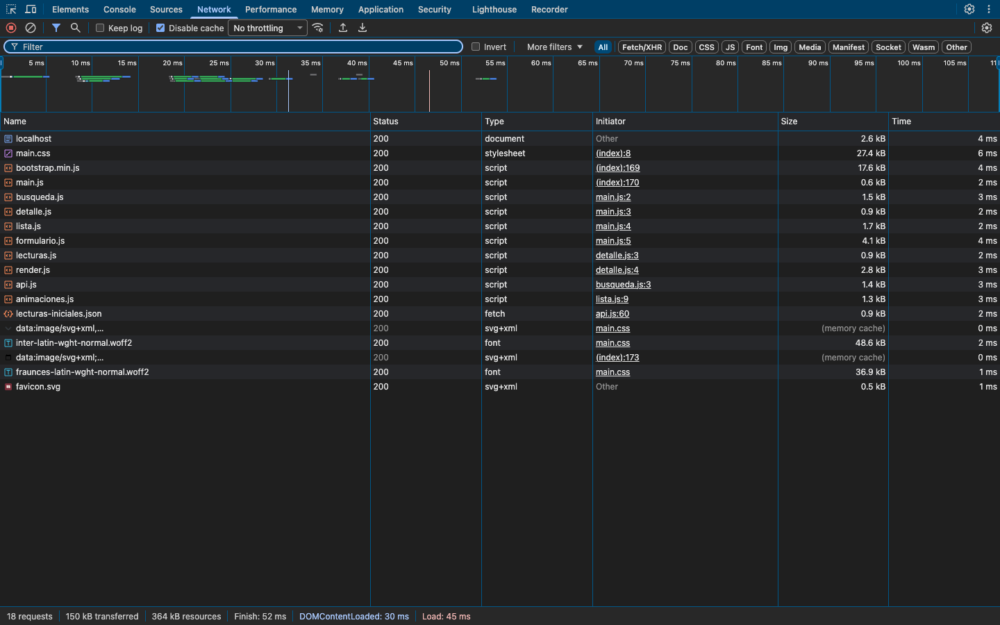

# Depuración y rendimiento — Parte A

Este documento registra un error real encontrado durante el desarrollo del buscador, cómo se localizó con las herramientas del desarrollador, el análisis del panel de red y la optimización aplicada con su medición.

Las capturas están en [`capturas/`](capturas/).

## 1. Error real: el género del formulario nunca era válido

### Síntoma

Con todos los campos del formulario de propuesta completos, el envío se rechazaba con la alerta "Revise el formulario". El campo **Género** quedaba en rojo con el mensaje:

> El género debe tener al menos undefined caracteres (tiene 8).

La palabra `undefined` en el mensaje indicaba que algún valor se estaba leyendo de una propiedad que no existe en ese elemento.



### Localización con puntos de interrupción

1. En **Sources**, se abrió `js/formulario.js` y se colocó un punto de interrupción en la línea 57, la primera de `reglaLongitudMinima()`: la función que arma el mensaje "debe tener al menos … caracteres".
2. Para no detenerse en cada campo, se convirtió en **punto de interrupción condicional** con la condición `campo.name === 'genero'`.
3. Al enviar el formulario, la ejecución se detuvo en `reglaLongitudMinima()`. El **Call Stack** muestra el recorrido desde el envío: `enviar` → `validarFormulario` → `validarCampo` → `reglaLongitudMinima`. En línea, DevTools indica `campo = select#genero.form-select`.
4. Con **Step over** se ejecutó la desestructuración y la ejecución quedó en la línea 60, la condición de salida. En el panel **Scope** se observa:
   - `campo`: `select#genero.form-select`
   - `minLength`: `undefined`
   - `value`: `"Fantasía"`



5. Con la ejecución detenida, en la **Console** se evaluó cada parte de la condición:

   ```js
   if (minLength <= 0 || value === '' || value.length >= minLength) return '';
   ```

   | Expresión | Resultado |
   |---|---|
   | `minLength` | `undefined` |
   | `minLength <= 0` | `false` |
   | `value.length >= minLength` | `false` |
   | `!(minLength > 0)` | `true` |

   Las dos comparaciones con `undefined` dan `false`, así que la función no salía y continuaba hasta devolver el mensaje de error. La última expresión es la que se usó para corregirlo.



### Causa

`minLength` es una propiedad de `<input>` y `<textarea>`, pero **no existe en `<select>`**. La regla se escribió pensando solo en campos de texto y suponía que `minLength` siempre era un número. Cualquier comparación numérica con `undefined` devuelve `false`, de modo que la condición de salida nunca se cumplía para el `<select>`.

### Corrección

La condición se reescribió para que solo continúe cuando `minLength` es un número positivo:

```js
// Los <select> no tienen minLength (es undefined), así que la regla no aplica.
if (!(minLength > 0) || value === '' || value.length >= minLength) return '';
```

`undefined > 0` es `false`, así que `!(undefined > 0)` es `true` y la función sale de inmediato para el `<select>`. Al repetir el envío con el punto de interrupción, la función retornó `''` en esa línea y la propuesta se registró correctamente.

### Otros errores encontrados en el desarrollo

- **Botones dentro de `form.elements`.** La primera versión validaba todo `form.elements`, que también incluye los `<button>` (tienen `willValidate === true`). Como los botones no tienen un `.invalid-feedback` al lado, `validarCampo()` lanzaba `TypeError: Cannot set properties of null`. Se resolvió filtrando con `esCampo()`, que solo acepta `INPUT`, `SELECT` y `TEXTAREA`.
- **`transitionend` que no llega.** Al quitar un libro de la lista, la fila se retira del DOM al terminar su transición. Con la pestaña en segundo plano, el navegador no dispara `transitionend` y la fila quedaba en el DOM. [`animaciones.js`](../buscador-js/js/animaciones.js) agrega un temporizador de respaldo con la duración de la transición.

## 2. Análisis del panel de red

Medición en **Network**, con **Disable cache** activado y recargando la página completa con `npm start`, antes de ejecutar ninguna búsqueda.



| Recurso | Tipo | Transferido |
|---|---|---|
| `index.html` | document | 2,6 kB |
| `css/main.css` | stylesheet | 27,4 kB |
| `bootstrap.min.js` | script | 17,6 kB |
| `js/*.js` (9 módulos) | script | 15,1 kB |
| Fuentes Inter y Fraunces | font | 85,5 kB |
| `data/lecturas-iniciales.json` | fetch | 0,9 kB |
| `favicon.svg` | svg | 0,5 kB |
| **Total** | **18 peticiones** | **150 kB transferidos / 364 kB recursos** |

El servidor de `npm start` comprime las respuestas, por eso lo transferido (150 kB) es mucho menor que el tamaño real de los recursos (364 kB). De las 18 peticiones, 2 son iconos SVG que Bootstrap incrusta en el CSS como `data:` y se resuelven desde memoria, sin ir a la red. La página termina de cargar en unos 50 ms en local.

Las portadas de las lecturas iniciales vienen de `covers.openlibrary.org` y se piden al dibujar la tabla (unos 40 kB para las 4).

Observaciones:

- **El CSS es el recurso propio más pesado** (172,7 kB sin comprimir, casi la mitad de los recursos), por eso la optimización de la sección 3 se concentró en él. Las fuentes pesan más transferidas porque `woff2` ya viene comprimido y no se reduce más.
- **Los módulos ES se piden en cascada.** El navegador descarga `main.js`, lee sus `import` y recién entonces pide `busqueda.js`, `lista.js`, etc. Son 9 peticiones pequeñas; con un servidor local el efecto es mínimo, pero en producción convendría empaquetarlos en un solo archivo.
- **Las fuentes llegan después del CSS**, porque el navegador solo las descubre al leer los `@font-face`. `font-display: swap` evita que el texto quede invisible mientras tanto.

### Búsqueda

Una búsqueda agrega **1 petición** a `openlibrary.org/search.json` (9,5 kB para "borges") y una petición por cada portada que entra en pantalla. Las portadas usan `loading="lazy"`: de los 12 resultados, solo se descargaron las que eran visibles; las demás se piden al desplazarse.

## 3. Optimización aplicada

### Qué se cambió

1. **Importar solo los parciales necesarios de Bootstrap.** En lugar de `@import "bootstrap/scss/bootstrap"`, [`_bootstrap.scss`](../buscador-js/scss/_bootstrap.scss) importa la configuración, la base, la grilla, las utilidades y únicamente los componentes que usa la interfaz (tablas, formularios, botones, navegación, navbar, tarjetas, insignias, alertas, botón de cierre, modal y spinners). Se omitieron dropdown, button-group, accordion, breadcrumb, pagination, progress, list-group, toasts, tooltip, popover, carousel, offcanvas y placeholders.
2. **CSS comprimido.** El script `build:css` compila con `--style=compressed`.
3. **JavaScript de Bootstrap sin Popper.** Se cambió `bootstrap.bundle.min.js` por `bootstrap.min.js`. Popper solo lo necesitan dropdowns, tooltips y popovers, que la interfaz no usa; el modal, el menú colapsable y el cierre de alertas funcionan igual.

Se verificó que todas las clases usadas en el HTML y en el JavaScript siguen presentes en el CSS generado.

### Medición

La versión anterior (commit `3010184`) se compiló y se sirvió por separado para medirla en el navegador con las mismas condiciones.

| Recurso | Antes | Después | Antes (gzip) | Después (gzip) |
|---|---|---|---|---|
| CSS (`main.css`) | 273,4 kB | 172,7 kB (−37 %) | 33,3 kB | 24,9 kB (−25 %) |
| JS de Bootstrap | 78,6 kB | 59,1 kB (−25 %) | 23,2 kB | 16,1 kB (−30 %) |
| **Total de ambos** | **352,0 kB** | **231,8 kB (−34 %)** | **56,5 kB** | **41,1 kB (−27 %)** |

La columna gzip indica lo que pesarían servidos con compresión, como haría un servidor de producción.

**Página completa (recursos sin comprimir):** antes, 13 peticiones y 391,8 kB; después, 364 kB. Las peticiones adicionales son las fuentes Inter y Fraunces (82,9 kB) y el favicon, incorporados después de la optimización. Sin las fuentes, la página optimizada pesa unos 281 kB, un 28 % menos que la versión anterior.
